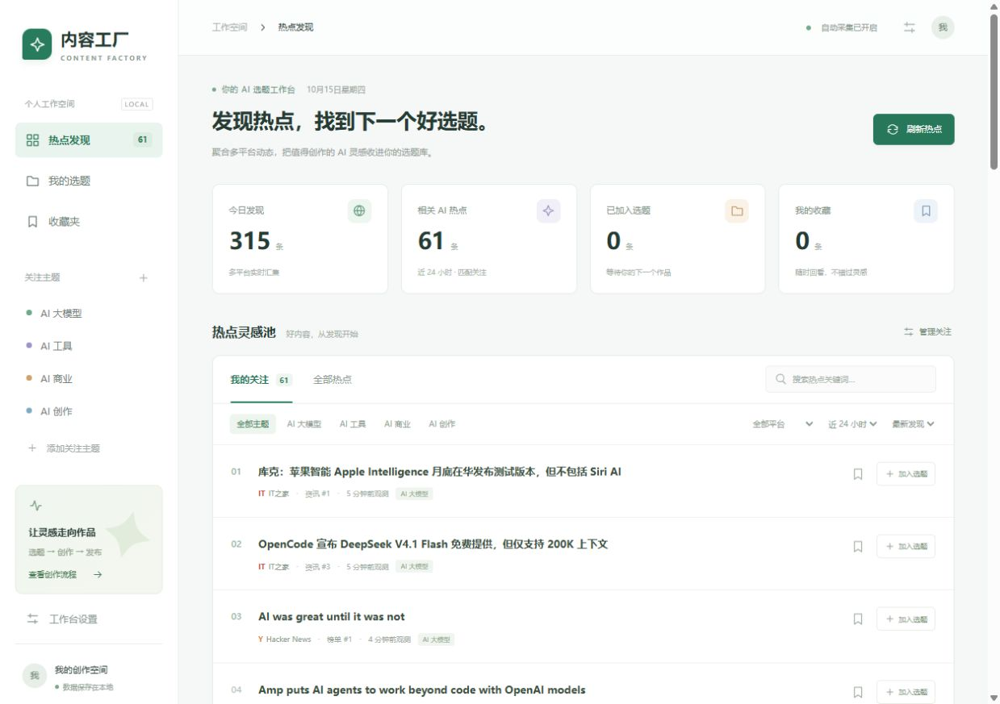

# 内容工厂 · AI 热点选题

一个可以实际采集、筛选和积累 AI 选题的本地工作台。基于 [NewsNow](https://github.com/newsnext/newsnow) 的 MIT 开源代码改造，保留平台采集器与许可证。

## 启动

需要 Node.js 24+、pnpm 10.30.3。项目仓库：[qiuquanhui/content-factory](https://github.com/qiuquanhui/content-factory)。

```sh
npm run dev
```

打开 http://127.0.0.1:3000 。服务启动后自动采集；默认 10 分钟更新一次，服务常驻时关闭浏览器仍会运行。

首次获取项目并安装依赖：

```sh
git clone https://github.com/qiuquanhui/content-factory.git
cd content-factory
npx pnpm@10.30.3 install --frozen-lockfile
```

生产运行：

```sh
npm run build
npm start
```

开发和生产使用同一端口，切换前先停止开发服务。默认仅监听本机。数据位于 `.data/content-factory.sqlite`，请保留此目录；修改位置可设置 `CF_DATABASE_PATH`。

## 已有功能

- 微博、知乎、百度、今日头条、抖音、B站、Hacker News、IT之家、AIHOT、OpenAI 官方 RSS，共 10 个源。
- 默认 AI 大模型、AI 工具、AI 商业、AI 创作四个主题；支持自定义关键词、排除词和启停。
- 按主题/平台/时间筛选、本地搜索、分页、源内顺序排序。
- 收藏、加入选题、导出带来源的 JSON 选题资料，重启后保留。
- SQLite 持久化、无人值守调度、请求取消与超时、部分源失败隔离、自动退避、30 天历史清理。
- 手机和桌面布局，设置抽屉、空态、加载态与失败状态。

列表默认按发现时间窗口交错各源的顺序，减少单个平台刷屏；源内位置不是统一热度。RSS 是资讯序号，不代表平台热榜。采集时间不等于文章发布时间。上游平台可能调整接口，单次实测成功不意味着永久可用。

## 扩展方式

```text
shared/content-factory.ts                    前后端稳定数据契约
server/services/content-factory/
  providers.ts                              NewsNow + RSS 采集适配
  collector.ts                              调度、互斥、取消、失败隔离
  store.ts                                  SQLite、事务、历史、选题、事件
  matcher.ts                                可解释主题匹配
  pipeline.ts                               写作与发布适配器契约/注册表
  runtime.ts                                运行实例
server/api/cf/[...path].ts                   工作台 API
server/plugins/content-factory.ts           常驻调度生命周期
src/factory/                                页面与图标
```

后续写作实现 `WritingProvider`，发布实现 `PublishingProvider`，通过 `PipelineRegistry` 注册。选题使用稳定 ID，保留来源和 `topic.selected` 事件。发布契约包含幂等键；审核与各平台状态需在对应阶段实现。

当前只实现发现与选题。写作和发布是扩展契约，尚未实际接入模型或平台，不会假装已经能自动写文章/发布。

新增采集源：添加共享源元信息，注册 `CollectionProvider`，返回统一条目；任务、标签和页面无需理解具体平台。源请求需支持 AbortSignal。当前部署为单实例，扩展至多实例时应增加分布式任务协调。

## 测试

```sh
npm run test:run
npm run build
npm run typecheck
```

首次构建会生成前端自动导入和服务类型，之后可独立执行类型检查。测试使用隔离的内存/临时数据库，覆盖规则、重复采集、收藏与选题保留、重启恢复、事务、历史清理、任务互斥、取消和失败隔离。运行验证记录见 [测试验证](docs/verification.md)。

可选环境变量：`CF_DATABASE_PATH`（数据库路径）、`CF_AUTOCOLLECT=false`（暂停后台调度）。调试/部署需保持 Node 24+；本应用仓储使用 Node 内置 SQLite。

## 项目文档

完整入口：[docs/README.md](docs/README.md)。

- [使用手册](docs/user-guide.md)：筛选、收藏、选题与主题管理。
- [数据源说明](docs/data-sources.md)：十个来源的抓取方式与边界。
- [架构说明](docs/architecture.md)：模块、调度、数据流和数据库。
- [API 文档](docs/api.md)：已实现的接口与参数。
- [部署运维](docs/deployment.md)：本地、容器、环境变量、备份和排障。
- [扩展开发](docs/extensions.md)：新增采集源、作者风格写作、多平台发布。



GitHub Actions 会在推送 `main` 或创建 PR 时执行测试、构建和类型检查；当前不会自动发布网站或推送容器镜像。

## 来源

上游固定版本：`newsnext/newsnow@0560c993b226cd2fd07d8a79875d50551f52c584`。原始说明见 `README.upstream.md`，许可见 `LICENSE`。最初方案见 `docs/phase-1/`；当前实现以本说明及实际代码为准。
