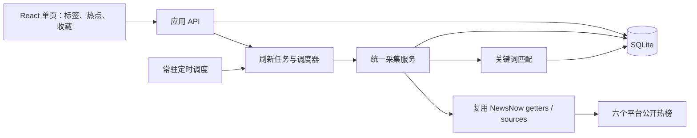

# 阶段一技术设计：基于 NewsNow 的最小改造

版本：v0.1（待确认）。本文件是拟实施方案，不表示已有代码或测试结果。

## 1. 设计决策

采用 NewsNow 固定版本 `0560c993b226cd2fd07d8a79875d50551f52c584`，优先复用整个工程，不将其拆成 SDK，不从零重写平台采集器。当前项目目录为空，确认后才引入上游代码；本次仅新增评审文档。

技术栈沿用 TypeScript、React、Nitro/H3、SQLite 和上游的 pnpm 锁文件。运行在常驻 Node 服务中，用单进程调度完成采集，首版仅运行一个应用实例。Node 具体版本与容器镜像在 PoC 中按锁文件构建结果固定，不直接沿用上游较旧 Docker 基础镜像。

如用户明确要求 Java，备选是将原版 NewsNow 作为独立采集服务，通过 HTTP 由 Java 应用封装。但这会增加独立应用、接口契约、部署和故障定位成本，不是当前首选。Java 代码块本身不视作已确认的技术栈要求。

## 2. 架构与数据流

一次采集先取每个启用源的榜单，再规范化并保存条目、快照和标签匹配。多个标签不会导致同平台重复请求。页面读取数据库，不在浏览页面时逐个平台采集。

首选同进程调用 `server/getters.ts`，避免通过 HTTP 请求自身，也避免直接套用旧接口中不够精确的缓存时间语义。上游旧 `/api/s` 可保留兼容，但新的主页面只用应用 API；旧接口同样必须经过调度间隔与并发约束，不能形成绕过入口。

## 3. 复用边界与拟改动

| 区域 | 处理方式 |
| --- | --- |
| `server/sources/` | 六个源尽量保持不变；仅在实测发现失效或超时无法终止时做定点补丁 |
| `server/getters.ts`、`shared/pre-sources.ts`、`shared/types.ts` | 复用注册、源信息及类型，不另建重复的平台体系 |
| `server/utils/fetch.ts` | 复用请求能力，必要时小改以透传可取消信号/统一时间预算 |
| 上游缓存表 | 保留其兼容用途；应用历史和真实采集状态放在独立前缀表中 |
| 新增 `server/services/content-factory/` | 集中实现 collector、matcher、topics、favorites、scheduler、repository |
| 新增 `server/api/cf/` | 标签、热点、收藏、刷新任务和源状态接口 |
| 新增服务启动插件 | 迁移数据库、恢复中断状态、启动单实例定时器，退出时停止 |
| `src/` 首页和少量组件 | 将多栏目页面收敛为列表、筛选条、设置抽屉；复用现成请求与样式能力 |
| 部署配置、测试 | 持久化目录、环境配置、必要质量检查和新增功能测试 |

目录名称为拟定值，开发时可依照上游习惯微调。新逻辑集中放置，减少未来升级冲突。保留上游许可证和来源说明；不直接复制 TrendRadar 核心代码到本实现。

## 4. 采集与调度

### 4.1 源清单

| 平台 | 上游源 ID | 返回内容定位 |
| --- | --- | --- |
| 微博 | `weibo` | 实时热搜 |
| 知乎 | `zhihu` | 热榜 |
| 百度 | `baidu` | 热搜 |
| 今日头条 | `toutiao` | 热榜 |
| 抖音 | `douyin` | 热榜 |
| B 站 | `bilibili-hot-search` | 热搜，首版不混入视频榜 |

这六个 ID 已通过源码元信息检查；网络可用性尚未实测。每源按实际有效条数保存，应用层首版最多取前 30 条，知乎等源可能不足 30 条。源内序号保存为 `rank`，不虚构官方热度。

### 4.2 执行机制

- 服务启动恢复配置并检查到期任务，随后每分钟检查一次；按默认 10 分钟或配置周期触发到期源。
- 每源有效周期取 `max(用户周期, 上游源最小间隔)`；停用源不调度。
- 采用进程内任务互斥、每源互斥与 SQLite 任务记录；同时最多采集 2 个源，重复手动刷新返回同一运行任务。
- 手动刷新 60 秒冷却；未到源更新间隔时返回已有数据和明确的跳过原因，不伪装成新采集。
- 沿用上游 HTTP 请求的重试，不再外叠“任务级三次重试”，避免请求倍增。校验失败、结构变化不盲目重试。
- 单源总预算拟定 60 秒，整轮预算 5 分钟；需将取消信号传递到实际 HTTP 请求，包括抖音获取临时 Cookie 的请求，不能只用 `Promise.race` 留下后台悬挂请求。具体可实现性在 PoC 核实。
- 失败保留最后成功快照，按后续正常周期重试；连续失败 3 次后该源退避至至少 30 分钟，成功后恢复；其他源不受影响。
- 首版不做多实例、分布式锁或消息队列。部署必须为单副本；需要横向扩容时再设计任务协调。

### 4.3 结果与时间语义

任务状态：`queued → running → success / partial_failed / failed / interrupted`。源本轮结果另有 `empty / skipped`，与异常、成功区分。

源返回 HTTP 成功后还要检查列表结构、非空标题、源 ID 和 URL。链接只接受 HTTP(S)，结合源域名规则验证；拒绝脚本链接。结构不符记失败，合法空数组记 empty，不更新“最后非空成功时间”，也不把上次榜单当当前榜单。

分别记录：任务请求时间、实际请求开始/结束时间、最后非空成功时间、返回条目的可选平台发布时间。`last_seen_at` 表示应用实际观测，缓存回读不能推动它。上游内部缓存若无法识别，显式记录 `freshness=unknown`；绝不声称数据来自刚刚的官方更新。

## 5. 标签与幂等

### 5.1 标签匹配

实现需求文档中的确定规则：命中词 OR、标签内排除词优先、中文子串、英文数字边界、NFKC 与大小写归一化。首版不引入大模型、向量库或任意用户正则。

记录 `matched_keywords` 和规则版本。标签变更后，串行重算保留期内条目的匹配，先写新版本结果再切换生效版本；界面显示处理中。采集期间按当前有效规则写匹配；新规则切换前补算本轮新条目，防止旧结果覆盖新规则。单用户、10,000 条基线下优先简单批量事务，不引入任务中间件。

### 5.2 条目身份与去重

源内身份键按优先级选择：稳定 `external_id` → 规范化 URL → `源 ID + 归一化标题哈希`。规范化 URL 保守处理已知追踪参数，不删除可能标识文章的业务参数。

条目唯一约束为 `(source_id, item_key)`，同一条目更新最后观测时间与当前信息，不重复插入。快照唯一约束为 `(snapshot_id, item_id)`；同批重试不会重复，新的实际采集批次保留新观测。

首版不自动合并不同平台的相似事件。例如“同一模型发布”在微博与知乎仍为两条，保留各自排名、来源和收藏。这样避免错误合并，也无需引入语义模型。跨平台聚类可在后续单独评估。

## 6. 数据结构

业务表统一使用 `cf_` 前缀，与上游 `cache`、用户表分开；通过小型版本迁移脚本维护，不先引入重型 ORM。

| 表 | 关键字段 | 约束/用途 |
| --- | --- | --- |
| `cf_settings` | schedule_minutes、timezone、schema_version | 单用户配置 |
| `cf_sources` | source_id、enabled、next_due_at、last_attempt_at、last_success_at、last_result、error_code、fail_count | 源开关、状态与退避 |
| `cf_tags` | id、name、include_words_json、exclude_words_json、enabled、rule_version、active_match_version | 规则与生效版本 |
| `cf_items` | id、source_id、item_key、external_id、title、summary、url、published_at、first_seen_at、last_seen_at | 唯一 `(source_id,item_key)`；发布时间可空 |
| `cf_snapshots` | id、job_id、source_id、requested_at、completed_at、result、freshness、item_count | 一次真实源观测；不是一次页面读取 |
| `cf_snapshot_items` | snapshot_id、item_id、rank、extra_json | 保存每次榜单位置；复合唯一键 |
| `cf_item_tags` | item_id、tag_id、rule_version、matched_keywords_json | 多标签匹配及可解释原因 |
| `cf_favorites` | item_id、created_at | 每条选题仅一份收藏；外键关联条目 |
| `cf_jobs` | id、trigger、status、started_at、finished_at、source_results_json | 调度证据、进度和失败摘要 |

索引围绕 `first_seen_at`、`source_id`、`last_seen_at` 和标签关联建立；数据库启用外键并按实际并发需求配置 WAL。单源结果的条目、快照、匹配与状态在短事务内提交，HTTP 请求在事务外进行。

清理：每日清理 30 天前快照和任务记录；删除超过保留期且未收藏的条目及关联；收藏保留最低必要条目信息，但不无限保留榜单快照。备份采用 SQLite 一致性备份或停写后复制，不能在 WAL 活跃时只随手复制主文件。

## 7. API 草案

统一使用 `/api/cf`。以下为产品接口设计，不将上游现有 API 错写成已有业务功能。

| 方法 | 路径 | 行为 |
| --- | --- | --- |
| GET | `/tags` | 查询规则及匹配更新状态 |
| POST | `/tags` | 创建标签，校验名称和词数量 |
| PATCH | `/tags/:id` | 编辑/启停并触发重算 |
| DELETE | `/tags/:id` | 删除规则与匹配，不删除收藏 |
| GET | `/topics?view=following&tagIds=...&sourceIds=...&range=24h&page=1&pageSize=30` | 从本地数据分页查询；页大小上限 100 |
| PUT | `/topics/:id/favorite` | 幂等收藏 |
| DELETE | `/topics/:id/favorite` | 幂等取消收藏 |
| GET | `/sources` | 平台开关、当前结果、上次成功和下一次计划 |
| PATCH | `/sources/:id` | 启停某源 |
| GET / PATCH | `/settings` | 获取/修改周期等配置 |
| POST | `/refresh` | 返回 202 和 jobId；运行中返回已有 jobId；冷却时返回结构化提示 |
| GET | `/jobs/:id` | 查询进度与源结果；运行时页面短轮询，完成停止 |
| GET | `/health` | 应用、数据库和调度器状态；外源健康另见 sources |

热点响应包含 `id/title/sourceId/sourceName/url/rank/tags/matchedKeywords/firstSeenAt/lastSeenAt/sourceLastSuccessAt/isCurrent/isStale/isFavorite`；不具备的摘要、发布时间或热度字段为可选值。所有时间为 ISO 8601 UTC，前端按上海时区显示。

API 统一返回错误码与可理解信息，如 `VALIDATION_ERROR`、`SOURCE_TIMEOUT`、`SOURCE_BLOCKED`、`SOURCE_PARSE_ERROR`、`DATABASE_UNAVAILABLE`，避免将堆栈直接展示给作者。外部标题按文本渲染，不作为 HTML 注入。

## 8. 极简前端

保留一个入口页面：上方标题、更新时间、刷新和设置；下方“我的关注/全部热点/已收藏”、标签与平台筛选、列表。设置抽屉承载低频配置，采集详情折叠显示。

首版不展示写作和发布的禁用占位按钮；待对应阶段实现后再增加真实操作。一次点击打开原文、一次点击收藏，收藏 ID 就是后续阶段二的选题入口。

页面区分首次加载、采集中、无匹配、无数据、部分失败、全部失败。历史内容附带时间和当前在榜状态，不能在故障时用旧数据造成实时更新的错觉。

## 9. 部署与维护

- 推荐本地常驻 Node 或单容器部署，挂载 SQLite 与日志目录；优先完成本地验证再交付容器启动方式。
- 固定上游 SHA、锁文件及验证后的镜像；不直接使用漂移的 `latest` 作为交付版本。
- 默认本机访问；如部署到私有服务器，由同一受控入口访问。公开服务或多用户需求需重新确认范围。
- 本阶段不需要大模型密钥和内容发布账号。上游源中已有的临时 Cookie 依赖记录为技术风险，日志不输出 Cookie。
- 日志包含 jobId、sourceId、结果、条数、耗时和错误类别。源失败状态在页面可见，无需外接监控平台。
- 维护清单单独记录修改过的源、原因及对应上游提交，更新采用人工检查差异后验证，不自动升级。

## 10. 确认后的分步开发

| 步骤 | 交付物 | 验证与退出条件 |
| --- | --- | --- |
| 0. 人工评审 | 确认选型、平台、标签含义、技术栈及部署假设 | 未确认前不开始代码开发 |
| 1. 最小 PoC | 固定源码、可启动环境、六源实测记录 | 每源三轮；核实超时、Cookie、返回字段及构建兼容性；有阻塞给具体替代方案 |
| 2. 采集与存储 | 迁移、collector、scheduler、状态和幂等快照 | 真实源跑通；故障隔离；关页面仍调度；重启恢复 |
| 3. 标签与选题 | 确定规则匹配、API、收藏、保留策略 | 样例测试、版本切换、收藏持久化、清理验证 |
| 4. 页面整合 | 单页列表、筛选、设置抽屉、刷新与状态 | 桌面/手机宽度、空态/失败态、原文/收藏路径验证 |
| 5. 交付验收 | 启动说明、测试报告、实测记录、验收清单 | 对齐需求文档 AC-01 至 AC-12，修复发现问题后邀请用户验收 |

初步工作量：PoC 约 0.5–1 个工作日，采集/存储/调度约 1–2 日，标签/API/收藏约 1–2 日，页面约 1 日，联调验收约 1 日，总计约 4.5–7 个工作日。这是范围估算，不是交付承诺；源失效或构建阻塞时先更新评估，不静默扩张范围。

## 11. 自主测试计划

测试用于验证业务行为和故障边界，避免仅复制实现逻辑。

| 层次 | 内容 | 证据 |
| --- | --- | --- |
| 上游基线 | 安装、构建、lint、typecheck、已有测试 | 分别记录通过/失败；既有失败明确归因，不宣称全绿 |
| 匹配单测 | OR、排除优先、中文与英文边界、NFKC、多标签、编辑重算 | 有预期结果的固定标题样例 |
| 存储/API 集成 | 重复采集、收藏幂等、事务失败回滚、规则版本切换、重启持久化、历史清理 | 使用隔离 SQLite 测试库 |
| 调度测试 | 到期触发、最小间隔、重复点击合并、运行中重启、退避、取消请求 | 可控时钟与 HTTP 桩；不等待长周期验证所有分支 |
| 实际平台冒烟 | 六源在部署网络实际取数，记录时间/条数/耗时 | PoC 三轮及最终验收一轮；外网失败单独列出 |
| 故障注入 | 单源/全源超时、403、HTTP200错误结构、合法空榜、旧缓存 | UI 与数据库状态一致，不伪造新鲜度 |
| 浏览器验收 | 标签设置、筛选、收藏、刷新、原文跳转、状态和窄屏 | 操作记录与必要页面截图 |
| 无人值守 | 浏览器关闭，服务常驻至少 30 分钟 | 至少三次默认周期到期调度的日志和任务记录 |

完成后向用户提交“版本、启动命令、测试结果、已知限制、验收路径”，再请用户按 AC 清单验收。当前仅完成开源调研和静态源码检查，运行测试尚未开始。

## 12. 风险处理和后续阶段

| 风险 | 处理 |
| --- | --- |
| NewsNow 停收外部贡献、向 NewsNext 迁移 | 固定版本、应用模块独立、小补丁清单；接受需要自行维护，不依赖未来合并 |
| 必须平台失效或限制访问 | PoC 提前发现；修复/替代/延期都给实测证据，范围变化再确认 |
| 热榜没有足够垂直行业内容 | 明确覆盖边界；后续可单独评估 RSS 或官方搜索源，本期不先集成 |
| 热度不可比、时间字段不完整 | 展示源内位置与观测时间，缺失字段留空 |
| 常驻进程被休眠/退出 | 展示最后成功时间，恢复后只补一次当前抓取；不保证关机期间运行 |
| 阶段二事实素材不足 | 收藏保存溯源入口，阶段二再建设素材获取与事实核对 |
| 阶段三平台发布受限 | 后续单独调研真实文章发布能力，不把消息 Webhook 当发布接口 |

整个三阶段建议增加共同原则：每篇内容可追溯到选题和来源；作者审核后发布；发布结果按平台单独记录，允许局部成功和重试。现在只保留稳定选题 ID，不提前开发这些功能。
