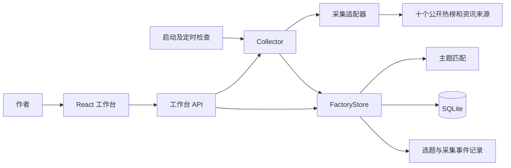

# 内容工厂方案设计

文档版本：1.0。对应项目版本：0.1.0。更新日期：2026-10-20。

本文说明如何实现 [需求分析](需求分析.md) 中的目标，区分现有设计与后续开发计划。

## 一、总体方案与选型

采用“复用开源采集器 + 单应用工作台 + 独立业务模块”的实现方式。基于 NewsNow 固定提交 `0560c993b226cd2fd07d8a79875d50551f52c584` 改造前后端，沿用平台采集、统一 getter、源元信息与请求封装。

| 选择 | 采用理由 | 权衡 |
| --- | --- | --- |
| NewsNow 作为基础 | 已有前端、服务和平台采集器，减少重写 | 上游维护变化和源失效需要自行处理 |
| TypeScript + React | 沿用原工程，前后端共享契约 | 当前没有额外引入 Java 服务 |
| Nitro/H3 常驻 Node 服务 | 页面 API 与后台任务放在一个应用内 | 当前需要单实例进程持续运行 |
| Node 内置 SQLite | 本地持久化和事务，降低部署成本 | 需要 Node 24+，多实例扩展需调整仓储与协调 |
| 确定规则匹配 | 可解释、不依赖模型密钥 | 无法覆盖关键词以外的语义关联 |

初始调研比较了 NewsNow、TrendRadar、DailyHotApi；调研结论与当时的社区指标保留在 [开源项目调研](phase-1/开源项目调研.md)，不将历史指标当作当前实时数据。

## 二、系统架构

前端读取本地结果，外部平台访问只发生在采集流程中。多个主题共享一次采集，避免为每个主题重复请求平台。

### 核心模块

| 模块 | 文件位置 | 职责 |
| --- | --- | --- |
| 共享契约 | `shared/content-factory.ts` | 源、主题、选题、任务与响应类型 |
| 采集适配 | `server/services/content-factory/providers.ts` | 包装 NewsNow getter 和 OpenAI RSS，转换统一条目 |
| 调度执行 | `collector.ts` | 到期判断、互斥、并发、超时和失败退避 |
| 请求上下文 | `request-context.ts` | 将 AbortSignal 传递到真实 HTTP 请求 |
| 主题匹配 | `matcher.ts` | 归一化、词边界、排除词与匹配原因 |
| 业务仓储 | `store.ts` | 事务、条目身份、快照、收藏、选题和清理 |
| 生命周期 | `runtime.ts`、`server/plugins/content-factory.ts` | 单例、启动恢复、定时器与退出清理 |
| 扩展接口 | `pipeline.ts` | 写作/发布接口及注册表，当前未注册执行适配器 |
| 服务入口 | `server/api/cf/[...path].ts` | 查询、配置、刷新与选题 API |
| 页面 | `src/factory/` | 工作台、筛选、列表、设置抽屉 |

更详细的模块说明见 [架构说明](架构说明.md)。

## 三、采集和匹配流程

1. 服务启动恢复中断任务，约 1.5 秒后检查到期来源，此后每分钟检查一次。
2. 自动采集间隔为用户周期与源最小间隔的较大值；手动刷新仍尊重源最小间隔。
3. 同时最多两个采集 worker，每源默认总预算 60 秒；运行中的刷新请求共享同一任务。
4. 适配器返回标题、链接、外部 ID 和可选摘要/发表时间，校验非空标题及 HTTP(S) URL。
5. 使用短事务保存条目、源状态和快照；同步计算当前主题匹配。
6. 单源失败保留历史数据；连续三次失败后重试间隔至少 30 分钟。
7. 任务完成保存结果和事件，再清理超过保留期的普通历史。

任务状态为 `running → success / partial_failed / failed / interrupted`；来源状态为 `pending / running / success / failed / empty`。合法空榜与结构异常分开记录。

关键词修改通过仓储事务重算已有条目并同步切换结果。首版没有异步规则版本切换或向量检索系统。

## 四、数据设计

数据库默认位于 `.data/content-factory.sqlite`，启用 WAL。当前业务表如下：

| 表 | 保存内容 |
| --- | --- |
| `cf_meta` | schema 初始化标记和采集设置 |
| `cf_tags` | 主题名称、关键词、排除词及开关 |
| `cf_sources` | 来源开关、请求/成功时间、状态、条数和错误 |
| `cf_items` | 稳定条目 ID、标题、来源、URL、观测时间、匹配、收藏和选题阶段 |
| `cf_jobs` | 任务时间、执行状态及各来源结果 |
| `cf_snapshots` | 每任务每源的条目 ID 和源内位置 |
| `cf_events` | 选题加入/移出与采集完成事件 |

条目身份优先使用外部 ID，否则使用 URL；由来源 ID 与身份键生成稳定 ID，唯一约束 `(source_id,item_key)`。同源重复采集更新条目，保留收藏及选题状态。不同来源不进行语义合并。

收藏与选题阶段目前存于条目表。普通数据默认保留 30 天；收藏或已选题条目保留必要来源信息，历史快照、任务和事件仍按保留期清理。未来新增文章、风格与发布表时，需要实现明确的 schema 版本迁移。

## 五、接口与页面设计

统一使用 `/api/cf`，主要接口按业务划分：

| 业务 | 接口 |
| --- | --- |
| 工作台查询 | `GET /dashboard`，汇总热点、统计、主题、源状态、设置及最新任务 |
| 刷新 | `POST /refresh`，运行中返回 202 和当前任务 |
| 主题管理 | `GET/POST /tags`，`PATCH/DELETE /tags/:id` |
| 来源开关 | `PATCH /sources/:id` |
| 周期设置 | `PATCH /settings` |
| 收藏 | `PUT/DELETE /topics/:id/favorite` |
| 加入选题 | `PUT/DELETE /topics/:id/select` |
| 资料导出 | `GET /topics/:id/export` |
| 健康检查 | `GET /health` |

页面采用主工作台、侧栏视图和设置抽屉。日常流程保持为“发现 → 收藏或加入选题”；低频操作集中在主题、数据来源、采集设置三个页签。未来创作和发布只有实现完整执行链后才提供实际操作入口。

接口参数、字段和错误说明见 [接口文档](接口文档.md)，页面用法见 [使用手册](使用手册.md)。

## 六、写作与发布扩展方案

### 作者风格写作

以稳定选题 ID 关联风格档案、素材和文章草稿。现有 `WritingProvider.generate` 接受选题、风格 ID、来源文本和取消信号，返回标题、Markdown 与引用。

后续需要新增风格档案、文章/草稿、执行任务表，接入真实模型，完成事实核对及 `selected → drafting → review` 状态机。注册表只负责管理适配器，不能代替这些业务功能。

### 多平台发布

现有 `PublishingProvider.publish` 接受文章 ID、标题、Markdown、幂等键和取消信号，返回平台外部 ID 与链接。每个平台独立处理认证和格式差异。

后续以“文章审核通过 → 创建每平台任务 → 分别执行 → 记录结果 → 对失败项重试”为主流程，新增发布任务、结果、幂等约束与对账机制。账号凭据仅由服务端管理。

### 事件与规模演进

当前 `cf_events` 仅记录事件，没有消费者。自动触发写作或发布前，需要增加消费确认、重复消费处理、重试和未处理事件的保留策略。

增加数据源按适配器扩展；增加模型或发布平台按各自接口扩展。多实例部署前再引入集中任务协调和适合并发的仓储，不直接复制当前单实例进程。

## 七、部署、验证与风险控制

支持本机 Node 和单容器部署。默认只监听本机，数据库目录持久化。关闭页面不影响常驻服务，关机、休眠或进程停止期间不执行采集。公网多人使用需要另行实现认证和权限。

测试分为规则与仓储自动测试、任务边界测试、API 验收、实际来源验证和浏览器检查。2026-10-20 本地复核为 55 项测试、构建与类型检查通过；长期稳定性及后续写作/发布不包含在当前验证结论中。

| 风险 | 设计应对 |
| --- | --- |
| 平台限流、页面改变、Cookie 失效 | 独立适配器、超时取消、退避、状态可见 |
| 重复请求或重复选题 | 任务互斥、来源最小间隔、身份唯一约束 |
| 故障时误显示新鲜内容 | 保留最后成功时间，标记历史数据和离榜状态 |
| 数据丢失 | SQLite 持久化、短事务、正常停写后备份或一致性备份 |
| 上游维护策略变化 | 固定源码版本，业务模块独立，记录小范围补丁 |
| 后续功能耦合 | 共享选题契约、独立适配器、显式状态机与版本迁移 |

部署与备份见 [部署运维](部署运维.md)；扩展步骤见 [扩展开发](扩展开发.md)；测试依据见 [测试验证](测试验证.md)。
