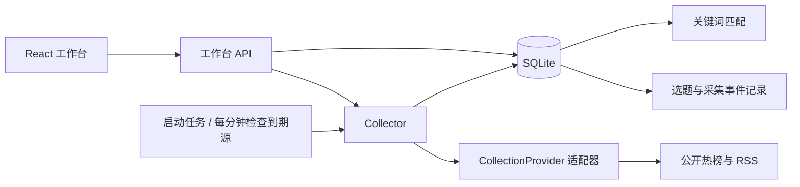

# 架构说明

## 技术与边界

前端使用 React、TanStack Router/Query、TypeScript；服务使用 Vite + Nitro/H3；业务仓储使用 Node 24 内置 SQLite。沿用 NewsNow 工程与采集器，新增业务集中在 `content-factory` 模块。

当前为单用户、单实例、常驻 Node 应用。没有单独的采集微服务、消息队列或模型服务依赖。

## 模块职责

| 路径 | 职责 |
| --- | --- |
| `shared/content-factory.ts` | 数据源、选题、标签、任务与前后端响应类型 |
| `server/services/content-factory/providers.ts` | 包装上游 getter 与官方 RSS，转换条目并校验 |
| `collector.ts` | 到期判断、互斥、两个 worker、超时取消、失败隔离与退避 |
| `request-context.ts` | 用 AsyncLocalStorage 将任务 AbortSignal 传至请求封装 |
| `matcher.ts` | 归一化、关键词边界与标签排除规则 |
| `store.ts` | SQLite 初始化、事务、去重、重匹配、选题、历史清理与事件 |
| `runtime.ts` | 业务仓储和 Collector 单例，恢复与关闭 |
| `pipeline.ts` | 写作/发布适配器契约及注册表，当前为空 |
| `server/plugins/content-factory.ts` | 启动和一分钟调度检查，退出时关闭任务和数据库 |
| `server/api/cf/[...path].ts` | 工作台 HTTP API |
| `src/factory/` | 页面、设置抽屉、图标及前端交互 |

## 采集生命周期

启动后约 1.5 秒检查到期源，此后每分钟检查。自动周期取用户配置与源最小间隔的较大值；手动刷新仍尊重源最小间隔。运行中请求复用当前任务，不启动重复任务。

任务状态为 `running → success / partial_failed / failed / interrupted`。源状态为 `pending / running / success / failed / empty`。数据请求在事务外执行，源结果在短事务中保存，避免网络等待锁住 SQLite。

源级 AbortController 限制整个采集，取消信号传入真实 HTTP 请求。服务关闭取消活动请求；重启把旧的 running 任务标记为 interrupted，被中断的源清除到期限制后优先重试。

## 存储模型

数据库默认 `.data/content-factory.sqlite`，启用 WAL、外键检查和 busy timeout。业务表与上游表用 `cf_` 前缀区分。

| 表 | 用途 |
| --- | --- |
| `cf_meta` | 当前 schema 标记、JSON 设置 |
| `cf_tags` | 主题规则 JSON |
| `cf_sources` | 开关、最后请求/成功时间、条数、错误和失败次数 |
| `cf_items` | 标题、摘要、URL、源内身份、位置、观测时间、匹配、收藏和阶段 |
| `cf_jobs` | 任务 JSON 与开始时间 |
| `cf_snapshots` | 每任务每源的条目 ID、位置和采集时间 |
| `cf_events` | `topic.selected`、`topic.deselected`、`collection.completed` 事件记录 |

源内身份优先为外部 ID，否则为 URL，生成稳定条目 ID；唯一约束 `(source_id,item_key)` 防止重复。收藏与选题阶段目前存于条目表，并非独立收藏表。标签修改会在事务中重算已有条目，结果同步切换。

采集后清理默认 30 天前的快照、任务和事件；旧条目只有同时“未收藏、未选题”才会删除。收藏与选题保留最低必要来源信息。当前 `schema=1` 是初始化标记，尚不是完整的版本迁移框架；未来改表需要增加明确迁移步骤。

## 后续扩展

选题阶段枚举保留 `discovered → selected → drafting → review → published`，当前 UI/API 只操作 discovered 与 selected。写作和发布采用独立适配器，接入步骤及需要补齐的状态机见 [扩展开发](扩展开发.md)。

事件当前仅为持久化记录，没有自动投递、消费确认和重试机制。多实例部署也尚未实现：需要先引入分布式调度协调和合适的仓储，再考虑横向扩容。
